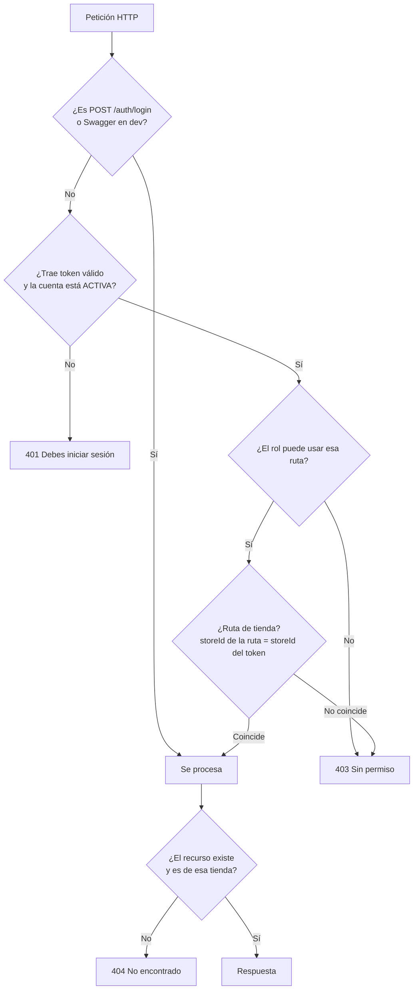
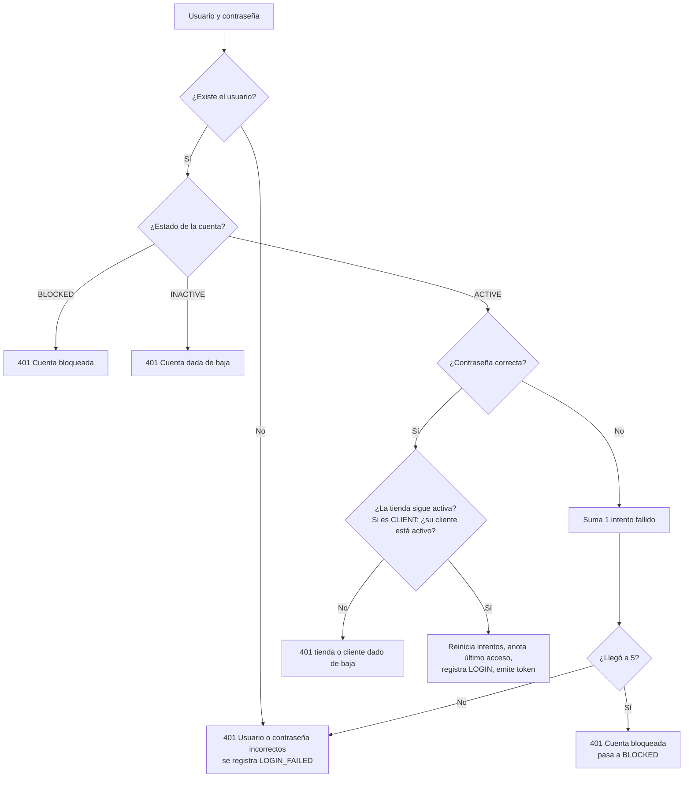
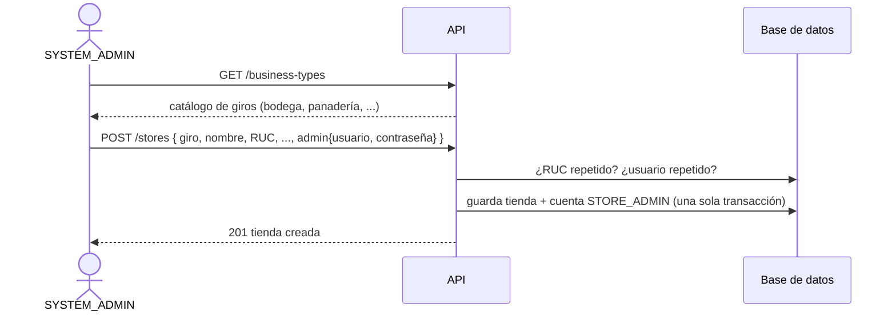
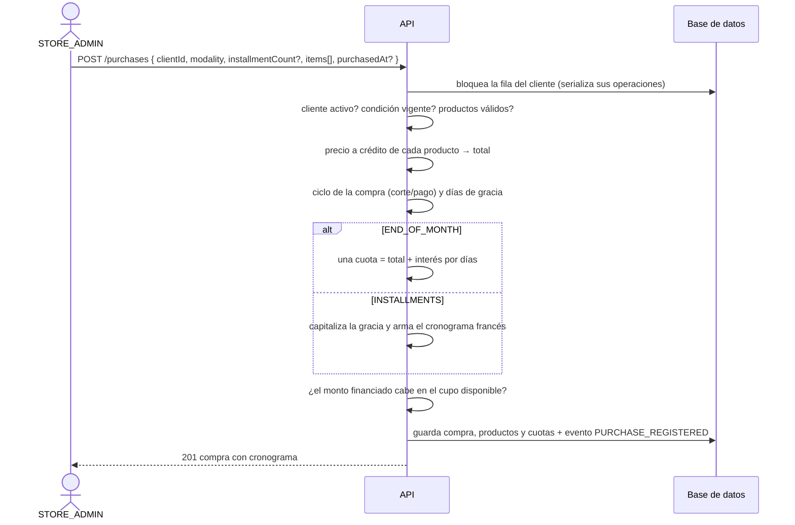
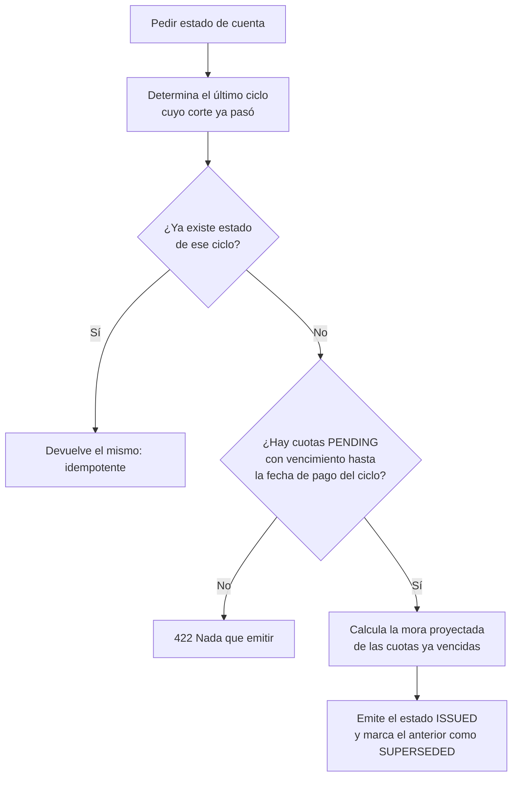

# Flujos de la aplicación

Este documento cuenta, escenario por escenario, **cómo se usa CrediFlow**: quién hace qué, con qué endpoint, qué reglas se aplican y qué responde el sistema cuando algo no se cumple. Va desde que el administrador del sistema crea una tienda hasta que un cliente consulta y paga su deuda.

> Todos los endpoints cuelgan de `/api/v1`. La documentación interactiva de la API está en Swagger UI (`/swagger-ui/index.html`) y el contrato OpenAPI en la ruta configurada en `springdoc.api-docs.path`.
> Los importes de los ejemplos son los que calcula el sistema (ver [formulas-financieras.md](formulas-financieras.md)).

---

## 1. Mapa general

### 1.1 Quién es quién

| Rol | Quién es | Qué puede hacer |
|---|---|---|
| `SYSTEM_ADMIN` | Administrador de la plataforma | Crear, editar y dar de baja tiendas; ver el catálogo de giros; gestionar las **cuentas de los administradores de tienda**; consultar la auditoría global. **No** ve compras, clientes ni deudas. |
| `STORE_ADMIN` | Dueño o encargado de una tienda | Todo lo de **su** tienda: productos, clientes, condiciones de crédito, compras, estados de cuenta, pagos, cuentas de sus clientes y auditoría de su tienda. |
| `CLIENT` | Cliente de una tienda | Solo **consultar lo suyo** (`/me/...`): perfil, condición y línea de crédito, compras, estados de cuenta y pagos. |

### 1.2 Cómo se decide el acceso



Puntos importantes:

- **Un recurso de otra tienda responde 404**, igual que uno que no existe: no se revela que existe.
- **La comprobación de cuenta activa se hace en cada petición**: dar de baja o bloquear una cuenta corta el acceso al instante, sin esperar a que venza el token.
- **El `storeId` y el `clientId` del cliente salen del token**, nunca de la ruta.

### 1.3 Formato de error

Todos los errores responden con el mismo cuerpo: `{"message": "..."}`.

| Código | Cuándo |
|---|---|
| 400 | Datos mal formados o inválidos (campo vacío, formato, JSON ilegible) |
| 401 | Sin sesión válida, o credenciales incorrectas en el login |
| 403 | Con sesión, pero sin permiso para esa ruta, esa tienda o esa cuenta |
| 404 | El recurso no existe o es de otra tienda |
| 422 | Se rompe una regla de negocio (cupo insuficiente, monto distinto al total, etc.) |

---

## 2. Arranque: el primer administrador del sistema

**Actor:** nadie (automático al iniciar la aplicación).

1. Al arrancar, `SystemAdminInitializer` revisa si ya existe algún `SYSTEM_ADMIN`.
2. Si no existe y están definidas `CREDIFLOW_ADMIN_USERNAME` y `CREDIFLOW_ADMIN_PASSWORD`, crea la cuenta con la contraseña cifrada (BCrypt).
3. Si ya existe, **no hace nada** (nunca toca una cuenta existente). Si faltan las variables, avisa en el log y sigue.
4. En el perfil `dev` (por defecto) vienen preconfiguradas: usuario `admin`, contraseña `Admin12345`. **Solo para desarrollo.**

Reglas: la contraseña debe tener al menos 8 caracteres o la aplicación no arranca. La clave de firma del JWT (`CREDIFLOW_JWT_SECRET`, mínimo 32 caracteres) también es obligatoria fuera de `dev`.

---

## 3. Inicio de sesión

**Endpoint:** `POST /auth/login` con `{ "username": "...", "password": "..." }`.



**Respuesta correcta (200):**

```json
{
  "accessToken": "eyJ...",
  "tokenType": "Bearer",
  "expiresAt": "2026-11-05T22:00:00Z",
  "user": { "id": 1, "username": "admin", "role": "SYSTEM_ADMIN", "storeId": null, "clientId": null }
}
```

Reglas y detalles:

- El usuario se normaliza a minúsculas: `ADMIN` y `admin` son la misma cuenta.
- **Usuario inexistente y contraseña incorrecta dan el mismo mensaje y tardan lo mismo**, para que no se pueda averiguar qué usuarios existen.
- **A los 5 intentos fallidos seguidos la cuenta se bloquea.** El contador se guarda aunque el login falle. Un acceso correcto lo reinicia.
- El token dura **8 horas**, no hay refresh: al vencer se vuelve a iniciar sesión.
- Para `STORE_ADMIN` y `CLIENT` el token lleva el `storeId`; para `CLIENT`, también el `clientId`.
- Cada intento queda en la **auditoría** (`LOGIN` o `LOGIN_FAILED` con el motivo).
- Usar el token: cabecera `Authorization: Bearer <token>`. En Swagger, botón **Authorize**.

Otros endpoints de sesión (cualquier rol autenticado):

| Endpoint | Para qué |
|---|---|
| `GET /auth/me` | Quién soy según el token |
| `PATCH /auth/password` | Cambiar mi contraseña (`currentPassword`, `newPassword`). Responde 204. Una contraseña actual equivocada cuenta como intento fallido. |

---

## 4. El administrador del sistema crea una tienda y su administrador

**Actor:** `SYSTEM_ADMIN`. **Endpoint:** `POST /stores`.



Reglas:

- El **RUC** tiene 11 dígitos, **no se repite** y **no se puede cambiar** después.
- El **giro** debe existir en el catálogo (`GET /business-types`).
- El bloque `admin` es obligatorio: usuario de 4 a 50 letras o números y contraseña de 8 a 100.
- **Tienda y administrador se crean en una sola transacción**: si el usuario ya existe (422), la tienda tampoco se guarda. Nunca queda una tienda sin administrador.
- Errores típicos: RUC repetido → 422; usuario repetido → 422; falta `admin` o datos inválidos → 400.

Otras operaciones del `SYSTEM_ADMIN` sobre tiendas:

| Endpoint | Para qué |
|---|---|
| `GET /stores` (filtro `status`) | Listar tiendas |
| `GET /stores/{id}` | Ver una tienda (también la puede ver su propio `STORE_ADMIN`) |
| `PUT /stores/{id}` | Editar datos (no el RUC) |
| `PATCH /stores/{id}/deactivate` | Baja lógica. **Se rechaza (422) si la tienda tiene cuotas pendientes de cobro.** Al darse de baja, sus usuarios ya no pueden iniciar sesión. |

---

## 5. El administrador de tienda prepara su negocio

**Actor:** `STORE_ADMIN`. Todo bajo `/stores/{su storeId}/...`.

### 5.1 Catálogo de productos y servicios

**Endpoints:** `POST/GET /products`, `GET/PUT /products/{id}`, `PATCH /products/{id}/deactivate`.

Cada producto tiene **precio al contado** y **precio a crédito**, moneda y banderas de modalidad (`endOfMonthAllowed`, `installmentsAllowed`; al menos una activa). Una compra a crédito siempre usa el **precio a crédito**. Un producto dado de baja no se puede comprar ni dar de baja otra vez (422).

### 5.2 Alta de un cliente

**Endpoint:** `POST /clients`. Datos: tipo y número de documento, nombre, contacto.

- El **documento no se repite dentro de la misma tienda** (422), pero una misma persona sí puede ser cliente de varias tiendas con perfiles independientes.
- Un cliente nuevo todavía **no puede comprar a crédito**: necesita una condición de crédito.

### 5.3 Condición de crédito

**Endpoint:** `POST /clients/{clientId}/credit-conditions`.

Se pacta, por cliente:

| Campo | Qué es |
|---|---|
| `creditLimit` + `currency` | Línea de crédito |
| `compensatoryRate` | Tasa de los intereses por financiar (efectiva o nominal con capitalización) |
| `lateRate` | Tasa moratoria |
| `maxInstallmentMonths` | Máximo de cuotas permitido |
| `cutoffDay`, `cutoffTime`, `paymentDay` | Corte y pago de cada ciclo |

```json
{
  "creditLimit": 1000.00,
  "currency": "PEN",
  "compensatoryRate": { "type": "NOMINAL", "value": 0.36, "period": "ANNUAL", "capitalization": "MONTHLY" },
  "lateRate": { "type": "NOMINAL", "value": 0.48, "period": "ANNUAL", "capitalization": "MONTHLY" },
  "maxInstallmentMonths": 12,
  "cutoffDay": 20,
  "cutoffTime": "18:00:00",
  "paymentDay": 26
}
```

Reglas:

- Las tasas se convierten a **TEA al guardarse** (36 % nominal mensual → TEA 0.425760887).
- Registrar una nueva **cierra la vigente** y pasa a ser la actual; el historial se conserva (`GET .../credit-conditions` y `.../credit-conditions/active`).
- **Una compra ya hecha conserva las tasas de su momento**: cambiar la condición no altera deudas anteriores.
- No se puede cambiar la moneda de la condición si el cliente tiene deuda pendiente (422), para no mezclar monedas en el cupo.
- Se consulta el estado del cupo con `GET /clients/{clientId}/credit-line`: límite, usado y disponible.

### 5.4 Cuenta de acceso del cliente (opcional)

**Endpoint:** `POST /clients/{clientId}/account` con `{ username, password }`.

- Un cliente tiene **como máximo una cuenta**, y debe estar activo (422 en otro caso).
- Dos altas simultáneas no pueden crearle dos cuentas.
- No existe registro público: **las cuentas las crea siempre un administrador**.
- Con esa cuenta, el cliente entra por `POST /auth/login` y usa el portal (sección 10).

---

## 6. Compra a crédito

**Actor:** `STORE_ADMIN`. **Endpoint:** `POST /purchases`.



Petición de ejemplo (compra a 3 cuotas):

```json
{
  "clientId": 1,
  "modality": "INSTALLMENTS",
  "installmentCount": 3,
  "purchasedAt": "2026-09-15T10:30:00",
  "items": [ { "productId": 2, "quantity": 60 } ]
}
```

Resultado: total de productos 300.00; corte 20/09, pago 26/09; 11 días de gracia; monto financiado 303.27; tres cuotas de 107.22, 107.22 y 107.20 que vencen el 26/10, 26/11 y 26/12.

Reglas:

- **Dos modalidades:** `END_OF_MONTH` (pago único en la fecha de pago del ciclo, sin `installmentCount`) e `INSTALLMENTS` (con `installmentCount` entre 1 y el máximo del cliente).
- **El precio lo pone el sistema**, no la petición: siempre el precio a crédito del producto.
- `purchasedAt` es opcional; si se omite se usa la hora actual. La compra que ocurre a partir del corte pasa al ciclo siguiente.
- **Cupo:** el monto financiado debe caber en el disponible (`límite − capital pendiente`). Si no, 422 con el monto y el cupo que quedaba.
- **No se puede registrar una compra con fecha retroactiva en un ciclo que ya tiene estado de cuenta emitido** (422): cambiaría un estado que el cliente ya recibió.
- Un cliente dado de baja no puede comprar (422).
- Si **cualquier** regla falla, no se guarda nada (ni compra ni auditoría).
- No existe anulación de compras en esta versión.

Consultas: `GET /purchases` (filtro `clientId`), `GET /purchases/{id}` (con productos y cuotas).

---

## 7. Estado de cuenta

**Actor:** `STORE_ADMIN` (o la tarea programada, si está activada). **Endpoint:** `POST /clients/{clientId}/statements` (el cuerpo es opcional: `{ "asOf": "2026-10-21T09:00:00" }`).



Qué contiene: las cuotas **pendientes que vencen hasta la fecha de pago del ciclo** (las del ciclo y las vencidas que se arrastran), con su capital, interés, días de atraso y mora proyectada, y el **total a pagar**.

Reglas:

- El cliente debe tener condición vigente; el ciclo facturado es el último cuyo corte (fecha y hora) ya pasó.
- Es **idempotente por cliente y ciclo**: pedirlo dos veces no duplica nada.
- Un ciclo anterior **no se puede emitir si ya existe uno posterior**: se generan en orden cronológico.
- El estado emitido anterior pasa a `SUPERSEDED`: el nuevo arrastra lo impago y lo reemplaza.
- No se emiten estados vacíos.
- `asOf` permite **simular otra fecha** (demostraciones y pruebas); sin él se usa la hora actual.
- **Automático:** una tarea programada puede generarlos al pasar el corte de cada cliente. Está **desactivada por defecto** (`crediflow.statements.scheduler-enabled=false`) y se activa en producción. La generación manual no depende de ella.

Consultas: `GET /statements` (filtro `clientId`), `GET /statements/{id}` (con cuotas; las vencidas arrastradas llevan `overdue = true`).

Estados posibles: `ISSUED` (vigente, por pagar), `PAID`, `SUPERSEDED`.

---

## 8. Pago de un estado de cuenta

**Actor:** `STORE_ADMIN`. **Endpoint:** `POST /statements/{statementId}/payments` con `{ "amount": 107.22, "paidAt": "2026-10-26T10:00:00" }`.

```mermaid
sequenceDiagram
    actor AD as STORE_ADMIN
    participant API as API
    participant DB as Base de datos
    AD->>API: POST /statements/{id}/payments { amount, paidAt? }
    API->>DB: bloquea al cliente de ese estado
    API->>API: ¿el estado está ISSUED y es el más reciente?
    API->>API: ¿paidAt no es futura ni anterior a la emisión?
    API->>API: por cada cuota: días de atraso reales → mora real
    API->>API: total = Σ (mora + interés + capital)
    alt amount ≠ total
        API-->>AD: 422 monto distinto; indica el total correcto
    else amount = total
        API->>DB: guarda el pago con su desglose por cuota<br/>cuotas → PAID, estado → PAID + evento PAYMENT_REGISTERED
        API-->>AD: 201 pago registrado
    end
```

Reglas:

- **No hay pagos parciales ni excedentes:** el monto debe ser **exactamente** el total calculado a la fecha del pago. Si no coincide, el 422 informa el total correcto.
- **La mora se calcula con los días reales** entre el vencimiento y la fecha del pago. Por eso el mismo estado cuesta más si se paga más tarde (ver el ejemplo 11.4).
- Solo se puede pagar el estado `ISSUED` más reciente. Pagar uno `SUPERSEDED` o ya `PAID` → 422.
- `paidAt` es opcional (por defecto, ahora), no puede ser futura ni anterior a la emisión del estado.
- No hay descuento por pago adelantado ni reversión de pagos.
- **Efectos al pagar:** las cuotas pasan a `PAID`, el estado a `PAID` y el **cupo se libera solo** (el capital pagado deja de contar como usado).
- El pago guarda para cada cuota la **imputación**: mora, interés compensatorio y capital.
- Dos pagos simultáneos del mismo estado no pueden ocurrir: el segundo ve el estado ya pagado.

Consultas: `GET /payments` (filtro `clientId`), `GET /payments/{id}` (con desglose por cuota y días de atraso).

---

## 9. Gestión de cuentas de acceso

**Actor:** `STORE_ADMIN` (sobre las cuentas **de cliente** de su tienda) y `SYSTEM_ADMIN` (sobre las cuentas de **administradores de tienda**, de cualquier tienda). Todas las rutas son `/stores/{storeId}/accounts/...`.

| Endpoint | Para qué | Regla |
|---|---|---|
| `GET /accounts` | Listar las cuentas que puedo gestionar | Cada rol ve solo las suyas |
| `PATCH /accounts/{id}/unblock` | Desbloquear una cuenta bloqueada por intentos fallidos | Si no está bloqueada → 422 |
| `PATCH /accounts/{id}/deactivate` | Dar de baja una cuenta | **No se puede dar de baja al único administrador activo de la tienda** (422) |
| `PATCH /accounts/{id}/password` | Restablecer la contraseña | No desbloquea la cuenta; en una cuenta de baja → 422 |

Reglas:

- Un `STORE_ADMIN` no puede gestionar a otro `STORE_ADMIN` (403), ni un `SYSTEM_ADMIN` a un `CLIENT`.
- Una cuenta de otra tienda en la ruta de la mía → 404 (o 403 si el `storeId` de la ruta no es el de mi token).
- Dar de baja o bloquear una cuenta **corta el acceso al instante**, aunque tenga un token vigente.
- Quien quiera cambiar su **propia** contraseña usa `PATCH /auth/password`.

Escenario típico — *un cliente se bloquea*:

1. Falla 5 veces la contraseña → `BLOCKED`.
2. El administrador de la tienda abre `GET /accounts`, encuentra la cuenta y llama a `PATCH .../unblock`.
3. Si además el cliente olvidó la contraseña: `PATCH .../password` con una nueva. Ambas acciones son independientes.

---

## 10. Portal del cliente

**Actor:** `CLIENT`. Todo bajo `/me/...`, solo lectura.

| Endpoint | Qué muestra |
|---|---|
| `GET /me/profile` | Mis datos |
| `GET /me/credit-condition` | Mi condición de crédito vigente |
| `GET /me/credit-line` | Límite, usado y disponible |
| `GET /me/purchases`, `/me/purchases/{id}` | Mis compras, y el detalle con cronograma |
| `GET /me/statements`, `/me/statements/{id}` | Mis estados de cuenta y su detalle |
| `GET /me/payments`, `/me/payments/{id}` | Mis pagos y su desglose |

Reglas:

- No hay `storeId` ni `clientId` en la ruta: salen del **token**. No existe ningún parámetro que permita ver a otro cliente.
- Pedir el detalle de algo que es de **otro cliente de la misma tienda** responde 404, igual que si no existiera.
- Un cliente **no puede** llamar a `/stores/...` (403); un administrador no puede llamar a `/me/...` (403).
- El cliente no registra compras ni pagos: eso lo hace la tienda, que es quien cobra.
- Un cliente dado de baja ya no puede iniciar sesión nueva, pero su historial se conserva.

---

## 11. Bajas y sus reglas

| Qué se da de baja | Endpoint | Se rechaza (422) si… | Qué pasa después |
|---|---|---|---|
| Producto | `PATCH /products/{id}/deactivate` | ya está de baja | No se puede comprar; el historial queda |
| Cliente | `PATCH /clients/{id}/deactivate` | ya está de baja o **tiene saldo pendiente** | No puede comprar ni iniciar sesión nueva; su historial se conserva |
| Cuenta | `PATCH /accounts/{id}/deactivate` | ya está de baja o es el **único admin activo** | Pierde el acceso al instante |
| Tienda | `PATCH /stores/{id}/deactivate` | ya está de baja o **tiene cuotas pendientes de cobro** | Sus usuarios dejan de poder iniciar sesión |

Todas son **bajas lógicas**: no se borra nada, el historial se conserva. Por eso son `PATCH .../deactivate` y no `DELETE`.

---

## 12. Auditoría

Se registra, de forma inalterable (solo inserción), quién hizo qué:

| Acción | Cuándo | Qué guarda |
|---|---|---|
| `LOGIN` | Inicio de sesión correcto | usuario, tienda, IP |
| `LOGIN_FAILED` | Intento fallido | usuario probado, motivo (usuario inexistente, contraseña incorrecta, cuenta bloqueada…), IP |
| `PURCHASE_REGISTERED` | Compra registrada | cliente, modalidad, monto financiado |
| `PAYMENT_REGISTERED` | Pago registrado | estado de cuenta, cliente, monto |

- El registro se guarda **en la misma transacción** que la operación: no puede haber una compra sin su evento ni un evento de una compra que no ocurrió. Si la operación falla (422), no queda ningún evento.
- Nunca se guarda una contraseña.

**Consulta (solo lectura):**

| Quién | Endpoint | Alcance |
|---|---|---|
| `STORE_ADMIN` | `GET /stores/{su tienda}/audit` | Solo su tienda |
| `SYSTEM_ADMIN` | `GET /audit` | Global; filtro opcional `storeId` |

Filtros comunes: `action`, `userId`, `from` y `to` (fechas inclusivas), y paginación. Más reciente primero.

---

## 13. Recorrido completo (de punta a punta)

Una historia real con los números del sistema. Tienda con condición de crédito: límite 1 000.00, TEA compensatoria 0.425760887 (36 % nominal mensual), TEA moratoria 0.601032219 (48 % nominal mensual), corte día 20 a las 18:00, pago día 26.

| # | Quién | Acción | Resultado |
|---|---|---|---|
| 1 | Sistema | Arranca la aplicación | Se crea el `SYSTEM_ADMIN` inicial |
| 2 | `SYSTEM_ADMIN` | `POST /auth/login` | Obtiene su token |
| 3 | `SYSTEM_ADMIN` | `POST /stores` con `admin` | Se crean la tienda y la cuenta `bodegaperez` (`STORE_ADMIN`) |
| 4 | `bodegaperez` | `POST /auth/login` | Token con su `storeId` |
| 5 | `bodegaperez` | `POST /products` (Arroz, a crédito 5.00/kg, ambas modalidades) | Producto creado |
| 6 | `bodegaperez` | `POST /clients` (Juan Pérez) | Cliente creado, sin crédito aún |
| 7 | `bodegaperez` | `POST /clients/1/credit-conditions` | Condición vigente; TEA 0.425760887 |
| 8 | `bodegaperez` | `POST /clients/1/account` (`juanperez`) | Juan tiene acceso al portal |
| 9 | `bodegaperez` | `POST /purchases` (60 kg de arroz, 3 cuotas, 15/09 10:30) | Total 300.00; financiado 303.27; cuotas 107.22 / 107.22 / 107.20 (26/10, 26/11, 26/12). Cupo: usado 303.27, disponible 696.73. Evento `PURCHASE_REGISTERED`. |
| 10 | `bodegaperez` | `POST /clients/1/statements` con `asOf` el 21/10 | Estado del ciclo con pago 26/10: una cuota de **107.22**, sin mora |
| 11 | `bodegaperez` | `POST /statements/{id}/payments` `{amount: 107.22, paidAt: 26/10}` | **201.** Cuota 1 `PAID`, estado `PAID`. Cupo: usado 205.15, disponible **794.85**. Evento `PAYMENT_REGISTERED`. |
| 12 | `juanperez` | `POST /auth/login` y `GET /me/credit-line` | Ve límite 1 000.00, usado 205.15, disponible 794.85 |
| 13 | `juanperez` | `GET /me/payments/{id}` | Ve el desglose: mora 0.00, interés 9.10, capital 98.12 |

### 13.1 Variante: el cliente no paga a tiempo

Siguiendo la historia: el cliente no paga la cuota 2 (vence el 26/11).

1. El 21/12 el administrador pide el estado de cuenta (`asOf`): el ciclo con pago 26/12 incluye **dos** cuotas: la cuota 2 (vencida, con 30 días de atraso hasta el 26/12) y la cuota 3 (vence el 26/12). Si ya se había emitido el estado de noviembre y seguía `ISSUED`, pasa a `SUPERSEDED`: el nuevo lo reemplaza y arrastra lo impago.
2. Mora proyectada de la cuota 2: 107.22 × 0.04 = **4.29** (la TEA moratoria equivale a 4 % a 30 días).
3. **Total del estado: 107.22 + 4.29 + 107.20 = 218.71.**
4. Si el cliente paga el 26/12, el pago debe ser exactamente **218.71**. Si lo intenta con 214.42 (sin la mora) o con 220.00, responde **422** indicando el total correcto.
5. Si paga días después, el total sube: el sistema **recalcula la mora con los días reales** y exige ese monto.
6. Tras el pago correcto, ambas cuotas quedan `PAID` y el capital pendiente de la compra es 0: el cupo vuelve a 1 000.00.

### 13.2 Variante: la compra no cabe en el cupo

Con usado 205.15 y disponible 794.85, una compra a 3 cuotas que financie más de 794.85 responde **422** con el monto que financiaría y el cupo que queda. No se guarda nada, ni auditoría.

### 13.3 Variante: compra después del corte

El 22/09 a las 10:00, después del corte del día 20 a las 18:00 del ciclo anterior, una compra a fin de mes de 100.00 pasa al ciclo con pago 26/10: 34 días de gracia y un interés de **3.41** (cuota única 103.41), no los 11 días del ciclo anterior.

---

## 14. Concurrencia

Todas las operaciones que tocan la deuda de un cliente (**compra, estado de cuenta, pago**) empiezan bloqueando la fila de ese cliente en la base de datos. Así se procesan **una detrás de otra** y cada una ve lo que la anterior ya confirmó. Eso evita, por ejemplo:

- que dos compras simultáneas superen juntas el cupo;
- que el mismo estado de cuenta se pague dos veces;
- que se emita un estado mientras se registra una compra.

---

## 15. Referencia rápida de endpoints

| Grupo | Endpoint | Rol |
|---|---|---|
| Auth | `POST /auth/login` | Público |
| Auth | `GET /auth/me`, `PATCH /auth/password` | Cualquier autenticado |
| Tiendas | `POST/GET /stores`, `PUT /stores/{id}`, `PATCH /stores/{id}/deactivate`, `GET /business-types` | `SYSTEM_ADMIN` |
| Tiendas | `GET /stores/{id}` | `SYSTEM_ADMIN`, o `STORE_ADMIN` de esa tienda |
| Cuentas | `GET /stores/{id}/accounts`, `PATCH .../accounts/{id}/unblock\|deactivate\|password` | `SYSTEM_ADMIN` (admins de tienda) / `STORE_ADMIN` (clientes) |
| Cuentas | `POST /stores/{id}/clients/{clientId}/account` | `STORE_ADMIN` |
| Productos | `/stores/{id}/products...` | `STORE_ADMIN` |
| Clientes | `/stores/{id}/clients...` (altas, edición, baja, condiciones) | `STORE_ADMIN` |
| Crédito | `GET /stores/{id}/clients/{clientId}/credit-line` | `STORE_ADMIN` |
| Compras | `POST/GET /stores/{id}/purchases`, `GET .../purchases/{id}` | `STORE_ADMIN` |
| Estados | `POST /stores/{id}/clients/{clientId}/statements`, `GET .../statements...` | `STORE_ADMIN` |
| Pagos | `POST /stores/{id}/statements/{id}/payments`, `GET .../payments...` | `STORE_ADMIN` |
| Auditoría | `GET /stores/{id}/audit` / `GET /audit` | `STORE_ADMIN` / `SYSTEM_ADMIN` |
| Portal | `GET /me/...` | `CLIENT` |

Toda ruta que no está en esta lista queda **denegada por defecto**.
